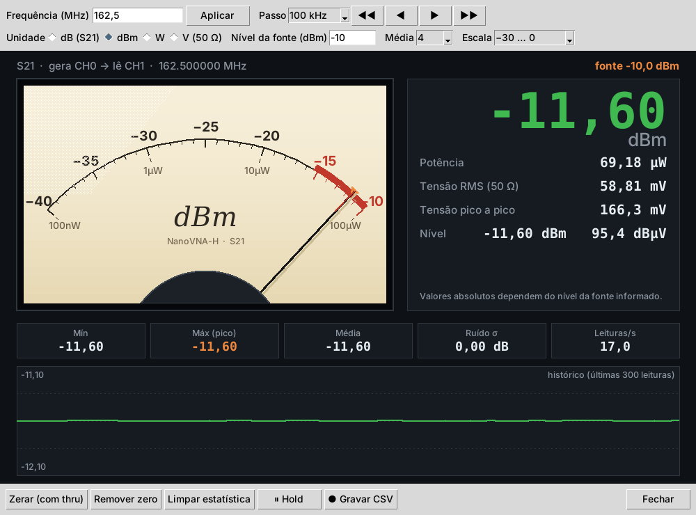

# NanoVNA Mirror e SV4401A Mirror

Espelhamento de tela e controle remoto para o **NanoVNA-H** e o **SV4401A**, com relatórios, gerador de sinal, medidor S21 e um conjunto de ferramentas de campo: localizador de falhas em cabos, perda e comprimento de cabo, filtros e duplexadores, componentes, cristais, casamento de impedância e histórico de antenas.

Inspirado no SVxx01A_Tools (do VNA SV4401A), mas feito para o NanoVNA-H com o firmware original edy555/hugen, que não tem comando de toque remoto. Por isso o controle é feito por abas e botões que enviam comandos seriais suportados pelo firmware.

O mesmo código gera dois programas: **NanoVNA Mirror** e **SV4401A Mirror** (veja [SV4401A](#sv4401a-mirror)).


## Recursos

- **Espelhamento da tela** em tempo real, ampliada e redimensionável, a partir do framebuffer do aparelho (comando `capture`).
- **Controle completo pelo PC**, organizado em abas:
  - **Estímulo:** início/fim, centro/span, faixas rápidas de radioamador, pausa e retomada.
  - **Traces:** formato (logmag, phase, delay, smith, polar, swr…), canal S11/S21, escala e referência.
  - **Marcadores:** posicionamento por frequência e leitura calculada de S11 (dB, SWR, R+jX, L/C equivalente) e S21 (dB e fase). Busca automática do SWR mínimo.
  - **Calibração:** sequência Open/Short/Load/Isolation/Thru e slots 0–4.
  - **Gerador:** portadora fixa (CW) na porta CH0, com passo ajustável e controle de drive.
  - **Sistema:** electrical delay, TDR, informações do aparelho.
- **Relatórios em PNG ou PDF** com cabeçalho (título, DUT, local, operador, data/hora), tela ampliada, resumo do S11 (SWR mínimo, banda com SWR ≤ 2) e tabela de marcadores.
- **Medidor S21** com VU analógico: gera em CH0 e lê em CH1 em span zero, com leitura em dB, dBm, W ou V (50 Ω) — potência em nW/µW/mW e tensão em µV/mV, além de dBµV — pico, mínimo, média, histórico, referência com thru e registro em CSV.
- **Exportação Touchstone** `.s1p` e `.s2p`.
- **Console** para enviar qualquer comando do shell do NanoVNA.



## Ferramentas (menu Ferramentas)

As ferramentas fazem varreduras próprias em blocos de 101 pontos emendados (até 1010 pontos) e devolvem a faixa original ao terminar.

| Ferramenta | O que faz |
|---|---|
| **Localizador de falhas no cabo (DTF)** | Transformada para distância (modo passa-banda): mostra a reflexão ao longo da linha e lista conectores ruins, emendas e danos com distância e perda de retorno. Compensa a perda do cabo e calibra o fator de velocidade com um cabo de comprimento conhecido. |
| **Cabo: perda, comprimento e stub** | Com a ponta aberta ou em curto: perda (metade da perda de retorno), comprimento elétrico pelo atraso de grupo e fator de velocidade real. Projeto de stubs λ/4 e λ/2 e quanto cortar a partir da ressonância medida. |
| **Filtros e duplexadores** | Banda a −X dB, perda, ripple, notch, rejeição e perda de retorno; fator Q (QL, Qu de cavidade e Q do notch); máscara de duplexador com aprovado/reprovado; modo ao vivo para sintonia e zoom nos canais. |
| **Medidor de componentes** | L, C, R, Q e autorressonância na frequência de trabalho, por reflexão (S11) ou por S21 em série ou em derivação. |
| **Analisador de cristal** | fs, fp, Rm, Lm, Cm, C0 e Q pelo método de −3 dB, em três passadas automáticas. |
| **Casamento de impedância** | Todas as redes L que levam a carga a 50 Ω, com valores E12 e SWR resultante, e o caminho na carta de Smith. |
| **Histórico e comparação** | Guarda a medição da instalação de cada antena e compara com a de hoje: deslocamento da ressonância, SWR mínimo, banda e alertas. |
| **Tabela de cabos** | Fator de velocidade e atenuação de cabos comuns (RG-58, RG-213, RG-8X, LMR, Heliax…), editável. |

A tabela de cabos traz valores típicos de catálogo; confira o datasheet do cabo usado. Edições ficam em `~/.nanovna_mirror_cabos.json` e o histórico em `~/NanoVNA_Mirror/historico/`.

## SV4401A Mirror

Versão para o VNA SV4401A (SYSJOINT, firmware 0.7.x ou mais recente), com as mesmas ferramentas:

- **Toque remoto:** clique na tela espelhada (1024×600) para tocar no aparelho; clique e arraste funciona como arrastar o dedo. Todos os menus do SV4401A ficam acessíveis pelo PC.
- **Varreduras de 101 a 1001 pontos** e faixa de 50 kHz a 4,4 GHz, com atalhos para UHF, 23 cm e 2,4 GHz.
- **Ferramentas mais rápidas:** cada `scan` traz até 1001 pontos com S11 e S21 numa única resposta, e o DTF limita a faixa automaticamente para a perda de ida e volta do cabo não passar de 20 dB.
- Calibração Open/Short/Load/Thru e slots 0–17.
- Sem as abas Traces e Gerador (use os menus do aparelho pelo toque).

O formato do comando de toque é descoberto ao conectar (o firmware imprime a sintaxe ao receber `touch` sem argumentos) e pode ser trocado na aba **Sistema**.

```bash
python sv4401a_mirror.py
```

## Download (Windows)

Baixe na página de **[Releases](../../releases)** o pacote do seu aparelho, `NanoVNA_Mirror_Windows.zip` ou `SV4401A_Mirror_Windows.zip`, extraia e execute o `.exe`. Não é preciso instalar Python.

> Na primeira execução o Windows pode exibir o aviso do SmartScreen ("O Windows protegeu o computador"), porque o executável não tem assinatura digital. Clique em **Mais informações → Executar assim mesmo**.

Requisitos: Windows 10 ou 11 (64 bits) e cabo USB de dados.

## Executar a partir do código-fonte

Requer Python 3.8 ou mais recente (Windows, Linux ou macOS).

```bash
git clone https://github.com/<seu-usuario>/nanovna-mirror.git
cd nanovna-mirror
python -m pip install -r requirements.txt
python nanovna_mirror.py
```

No Linux, o tkinter pode precisar ser instalado à parte (`sudo apt install python3-tk`), e o usuário precisa ter permissão de acesso à porta serial (grupo `dialout`).

## Gerar o executável

No Windows, dê dois cliques em `build.bat`. Ele instala as dependências e o PyInstaller, gera `dist/NanoVNA Mirror.exe` e `dist/SV4401A Mirror.exe` e monta os pacotes `.zip` com o LEIA-ME.

Manualmente:

```bash
python -m pip install pyinstaller
python -m PyInstaller --onefile --windowed --icon icon.ico --name "NanoVNA Mirror" nanovna_mirror.py
python -m PyInstaller --onefile --windowed --icon icon.ico --name "SV4401A Mirror" sv4401a_mirror.py
```

## Compatibilidade

| Aparelho | Firmware | Situação |
|---|---|---|
| NanoVNA-H (STM32F072, tela 320×240) | edy555 / hugen (2019) | Testado |
| NanoVNA-H | DiSlord | Deve funcionar; alguns formatos de comando podem variar |
| SV4401A (tela 1024×600) | 0.7.x ou mais recente | Testado em simulador; aguardando teste no aparelho |
| NanoVNA-H4 (tela 480×320) | qualquer | Não suportado ainda (resolução diferente) |
| NanoVNA V2 / LiteVNA | qualquer | Não suportado (protocolo binário diferente) |

Se o aparelho rejeitar algum comando, a resposta aparece no Console do programa.

## Limitações e cuidados

- **O medidor S21 não é um RSSI de sinais externos.** O receptor do NanoVNA é coerente com a própria fonte, então só mede corretamente o sinal gerado pelo próprio aparelho.
- **O gerador produz onda quadrada** (Si5351), com harmônicos fortes e nível aproximadamente fixo. Acima de ~300 MHz o aparelho usa o 3º harmônico, e a fundamental (f/3) sai mais forte que a frequência pedida.
- **Nunca conecte transmissores ou amplificadores de potência** diretamente às portas do NanoVNA. Use atenuadores adequados.
- A taxa de atualização da tela é limitada pela porta serial (poucos quadros por segundo).

## Como funciona

O NanoVNA aparece como porta serial virtual (USB CDC) com um shell ChibiOS. O programa usa os comandos de texto do próprio firmware:

| Função | Comando |
|---|---|
| Captura de tela | `capture` (framebuffer 320×240 em RGB565 big-endian) |
| Faixa de varredura | `sweep <início> <fim>` |
| Dados de medição | `frequencies`, `data 0` (S11), `data 1` (S21) |
| Traces e marcadores | `trace`, `marker` |
| Calibração | `cal`, `save`, `recall` |
| Gerador CW | `pause` + `freq <Hz>` |
| Medidor S21 | span zero (`sweep f f`) + média de `data 1` |
| Ferramentas | `scan <início> <fim> 101` por segmento + `data 0/1`; se o firmware não aceitar `scan`, usa `sweep` + `pause` |

Os valores de SWR, impedância e S21 são calculados a partir dos dados brutos (Z0 = 50 Ω), com mais precisão do que a tela do aparelho exibe.

No SV4401A o `capture` vem em 1024×600 RGB565 little-endian, as ferramentas usam `scan <início> <fim> <pontos> 7` (frequência, S11 e S21 na mesma resposta), o medidor usa `scan f f 101 4` e o toque usa `touch x,y DOWN/UP`.

## Estrutura do repositório

```
nanovna-mirror/
├── nanovna_mirror.py    # programa principal (NanoVNA Mirror)
├── sv4401a_mirror.py    # inicia o SV4401A Mirror
├── devices.py           # drivers dos aparelhos (NanoVNA-H, SV4401A)
├── tools_ui.py          # janelas das ferramentas
├── rf_tools.py          # cálculos de RF (DTF, filtros, componentes, cristal, rede L…)
├── cabos.py             # tabela de cabos
├── tests/               # testes dos cálculos (python tests/test_rf_tools.py)
├── make_icon.py         # desenha o ícone (janela e executável)
├── icon.ico             # ícone do executável (gerado pelo make_icon.py)
├── requirements.txt     # dependências Python
├── build.bat            # gera o .exe e o .zip de distribuição
├── docs/
│   ├── LEIA-ME.txt      # instruções incluídas no .zip para o usuário final
│   └── img/             # imagens usadas neste README
├── README.md
└── .gitignore
```

## Autor

Desenvolvido por **Ruy Lazaro**
[laztel.com.br](https://laztel.com.br) · ruylazaro.engenharia@gmail.com

Sugestões e relatos de problemas são bem-vindos na aba [Issues](../../issues).
