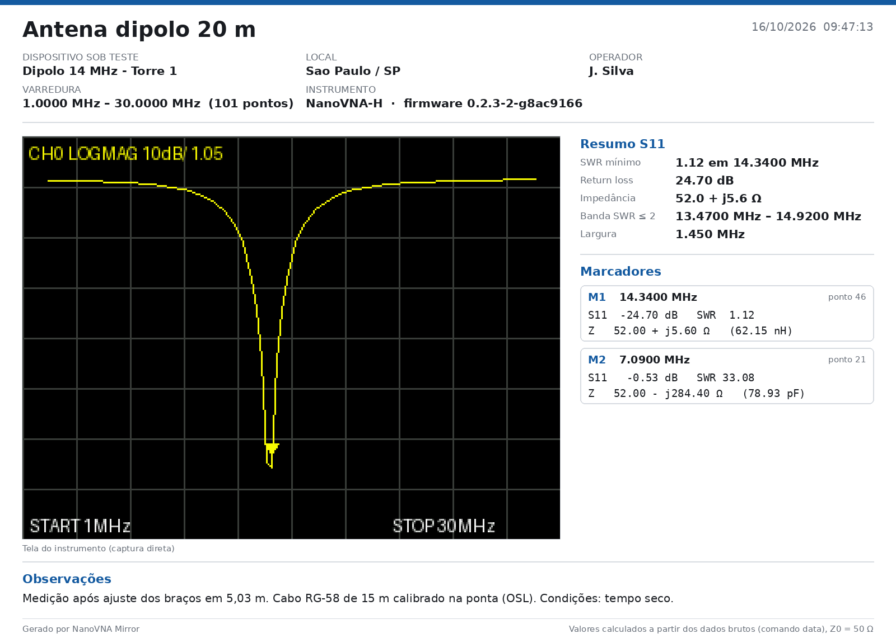
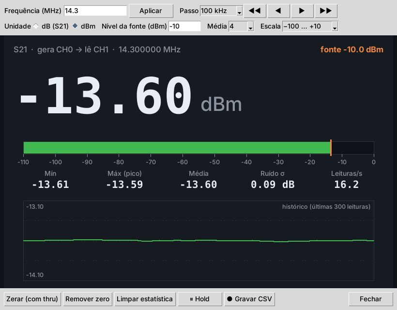

# NanoVNA Mirror

Espelhamento de tela e controle remoto para o **NanoVNA-H**, com geração de relatórios, gerador de sinal e medidor S21 estilo power meter.

Inspirado no SVxx01A_Tools (do VNA SV4401A), mas feito para o NanoVNA-H com o firmware original edy555/hugen, que não tem comando de toque remoto. Por isso o controle é feito por abas e botões que enviam comandos seriais suportados pelo firmware.



## Recursos

- **Espelhamento da tela** em tempo real, ampliada e redimensionável, a partir do framebuffer do aparelho (comando `capture`).
- **Controle completo pelo PC**, organizado em abas:
  - **Estímulo:** início/fim, centro/span, faixas rápidas de radioamador, pausa e retomada.
  - **Traces:** formato (logmag, phase, delay, smith, polar, swr…), canal S11/S21, escala e referência.
  - **Marcadores:** posicionamento por frequência e leitura calculada de S11 (dB, SWR, R+jX, L/C equivalente) e S21 (dB e fase). Busca automática do SWR mínimo.
  - **Calibração:** sequência Open/Short/Load/Isolation/Thru e slots 0–4.
  - **Gerador:** portadora fixa (CW) na porta CH0, com passo ajustável e controle de drive.
  - **Sistema:** electrical delay, TDR, informações do aparelho.
- **Relatórios em PNG ou PDF** com cabeçalho (título, DUT, local, operador, data/hora), tela ampliada, resumo do S11 (SWR mínimo, banda com SWR ≤ 2) e tabela de marcadores.
- **Medidor S21** estilo power meter: gera em CH0 e lê em CH1 em span zero, com leitura em dB ou dBm, barra, pico, mínimo, média, histórico, referência com thru e registro em CSV.
- **Exportação Touchstone** `.s1p` e `.s2p`.
- **Console** para enviar qualquer comando do shell do NanoVNA.



## Download (Windows)

Baixe o arquivo `NanoVNA_Mirror_Windows.zip` na página de **[Releases](../../releases)**, extraia e execute `NanoVNA Mirror.exe`. Não é preciso instalar Python.

> Na primeira execução o Windows pode exibir o aviso do SmartScreen ("O Windows protegeu o computador"), porque o executável não tem assinatura digital. Clique em **Mais informações → Executar assim mesmo**.

Requisitos: Windows 10 ou 11 (64 bits) e cabo USB de dados.

## Executar a partir do código-fonte

Requer Python 3.8 ou mais recente (Windows, Linux ou macOS).

```bash
git clone https://github.com/<seu-usuario>/nanovna-mirror.git
cd nanovna-mirror
python -m pip install -r requirements.txt
python nanovna_mirror.py
```

No Linux, o tkinter pode precisar ser instalado à parte (`sudo apt install python3-tk`), e o usuário precisa ter permissão de acesso à porta serial (grupo `dialout`).

## Gerar o executável

No Windows, dê dois cliques em `build.bat`. Ele instala as dependências e o PyInstaller, gera `dist/NanoVNA Mirror.exe` e monta o pacote `dist/NanoVNA_Mirror_Windows.zip` com o LEIA-ME.

Manualmente:

```bash
python -m pip install pyinstaller
python -m PyInstaller --onefile --windowed --name "NanoVNA Mirror" nanovna_mirror.py
```

## Compatibilidade

| Aparelho | Firmware | Situação |
|---|---|---|
| NanoVNA-H (STM32F072, tela 320×240) | edy555 / hugen (2019) | Testado |
| NanoVNA-H | DiSlord | Deve funcionar; alguns formatos de comando podem variar |
| NanoVNA-H4 (tela 480×320) | qualquer | Não suportado ainda (resolução diferente) |
| NanoVNA V2 / LiteVNA | qualquer | Não suportado (protocolo binário diferente) |

Se o aparelho rejeitar algum comando, a resposta aparece no Console do programa.

## Limitações e cuidados

- **O medidor S21 não é um RSSI de sinais externos.** O receptor do NanoVNA é coerente com a própria fonte, então só mede corretamente o sinal gerado pelo próprio aparelho.
- **O gerador produz onda quadrada** (Si5351), com harmônicos fortes e nível aproximadamente fixo. Acima de ~300 MHz o aparelho usa o 3º harmônico, e a fundamental (f/3) sai mais forte que a frequência pedida.
- **Nunca conecte transmissores ou amplificadores de potência** diretamente às portas do NanoVNA. Use atenuadores adequados.
- A taxa de atualização da tela é limitada pela porta serial (poucos quadros por segundo).

## Como funciona

O NanoVNA aparece como porta serial virtual (USB CDC) com um shell ChibiOS. O programa usa os comandos de texto do próprio firmware:

| Função | Comando |
|---|---|
| Captura de tela | `capture` (framebuffer 320×240 em RGB565 big-endian) |
| Faixa de varredura | `sweep <início> <fim>` |
| Dados de medição | `frequencies`, `data 0` (S11), `data 1` (S21) |
| Traces e marcadores | `trace`, `marker` |
| Calibração | `cal`, `save`, `recall` |
| Gerador CW | `pause` + `freq <Hz>` |
| Medidor S21 | span zero (`sweep f f`) + média de `data 1` |

Os valores de SWR, impedância e S21 são calculados a partir dos dados brutos (Z0 = 50 Ω), com mais precisão do que a tela do aparelho exibe.

## Estrutura do repositório

```
nanovna-mirror/
├── nanovna_mirror.py    # programa (arquivo único)
├── requirements.txt     # dependências Python
├── build.bat            # gera o .exe e o .zip de distribuição
├── docs/
│   ├── LEIA-ME.txt      # instruções incluídas no .zip para o usuário final
│   └── img/             # imagens usadas neste README
├── README.md
└── .gitignore
```

## Autor

Desenvolvido por **Ruy Lazaro**
[laztel.com.br](https://laztel.com.br) · ruylazaro.engenharia@gmail.com

Sugestões e relatos de problemas são bem-vindos na aba [Issues](../../issues).
